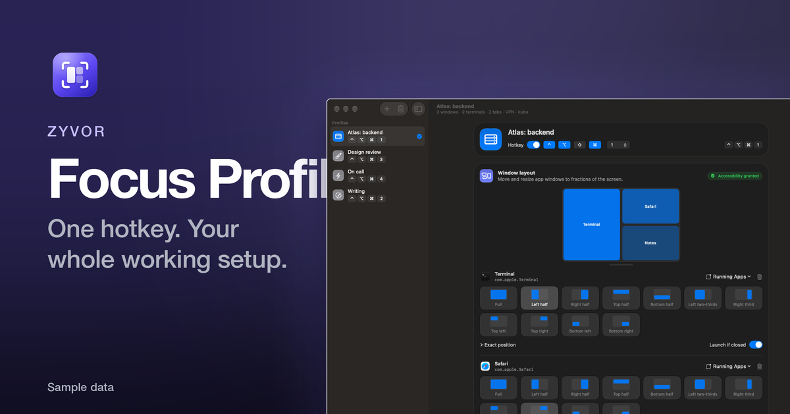
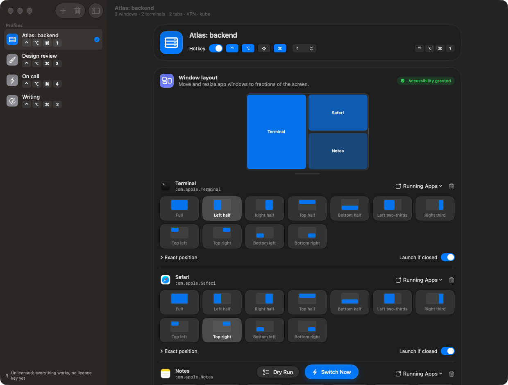
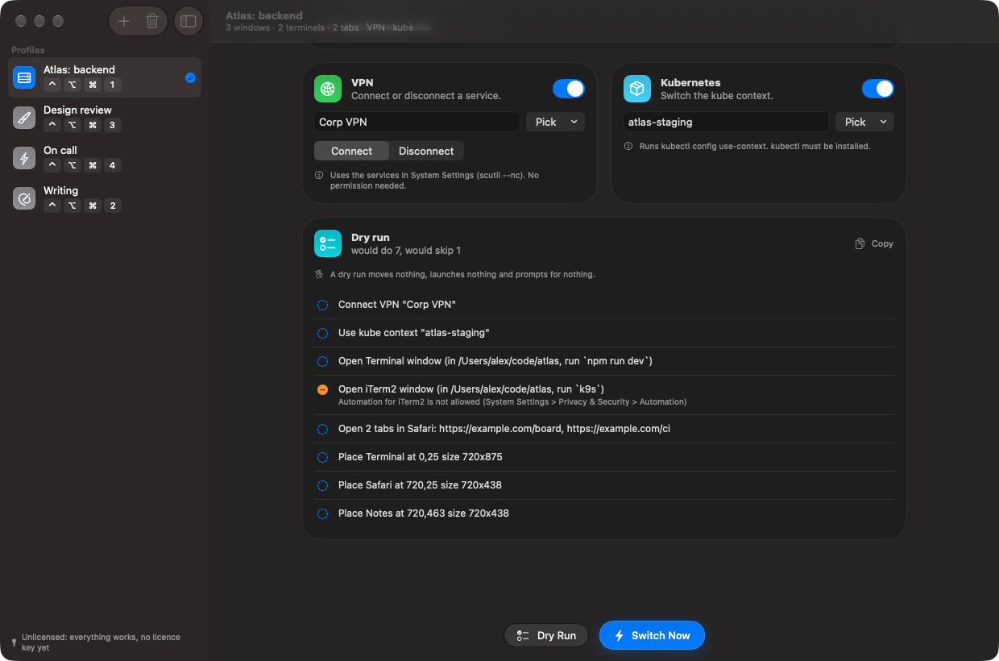
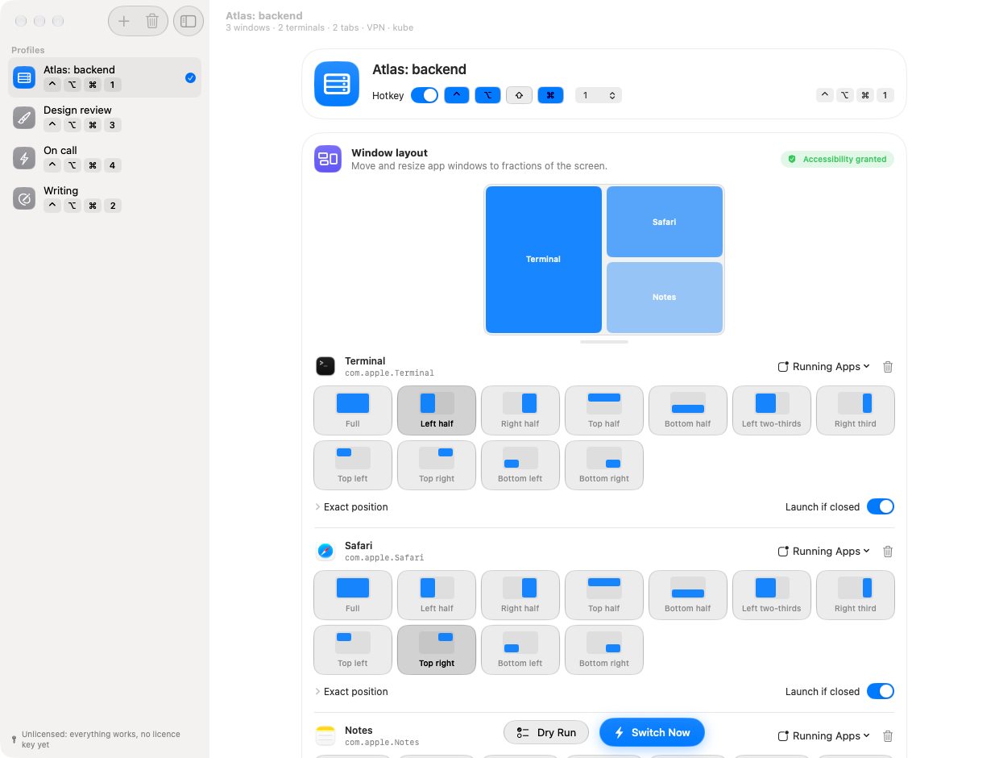
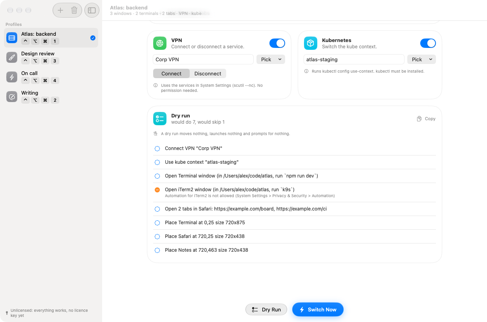

<div align="center">



# Focus Profiles

### One hotkey. Your whole working setup.

A per-project profile switcher for macOS. One hotkey sets your window layout, terminal windows, browser tabs, VPN and kube context.

<br />

**[Download the 30-day trial](https://github.com/zyvorai/focus-profiles/releases/tag/v0.1.0)** &nbsp;·&nbsp; [Website](https://zyvorai.github.io/focus-profiles/) &nbsp;·&nbsp; [Licence and trial](docs/LICENSING.md)

`FocusProfiles-0.1.0.dmg` · macOS 27 or later · Developer ID signed and notarized

</div>

---

## Download (trial)

| | |
| --- | --- |
| **Get it** | [Focus Profiles 0.1.0](https://github.com/zyvorai/focus-profiles/releases/tag/v0.1.0): `FocusProfiles-0.1.0.dmg` (the SHA-256 is in the release notes and in `FocusProfiles-0.1.0.dmg.sha256`) |
| **Free 30-day trial key** | **sales@zyvor.dev** (the app also works without a key) |
| **Requirements** | macOS 27 or later |
| **Notarized** | Developer ID signed and notarized by Apple |

Open the DMG and drag FocusProfiles to Applications. It lives in the menu bar. See [docs/INSTALL.md](docs/INSTALL.md).

## See it

*Screenshots are renders of the app's own views with sample data (an invented project called "Atlas"), not captures of a live session.*

| Profile editor | Dry run result |
| --- | --- |
|  |  |
|  |  |

## What it does

- **One hotkey per profile** switches your setup. Or switch from the menu bar.
- **Window layout** through the Accessibility API: each app's window as a fraction of the main display, with presets (halves, two-thirds, third, quarters) and capture of the frontmost window.
- **Terminal and iTerm2 windows** in a folder, running a command. **Safari and Google Chrome tabs.** Both use Automation (AppleScript).
- **VPN** through `scutil --nc` and **kube context** through `kubectl config use-context`.
- **Plain JSON profiles**, one file each, in `~/Library/Application Support/Focus Profiles/Profiles/`. See [docs/PROFILES.md](docs/PROFILES.md).
- **Dry run** shows what a switch would do and moves nothing. See [docs/DRY-RUN.md](docs/DRY-RUN.md).
- **Graceful skips:** if a permission is denied, those steps are skipped and reported and the rest of the profile still runs.

Real output of `FocusProfiles --dry-run` on the example profile:

```
Dry run for "Project Atlas": would do 6, would skip 0
  [would do] Connect VPN "Corp VPN"
  [would do] Use kube context "atlas-staging"
  [would do] Open Terminal window (in /Users/you/code/atlas, run `git status`)
  [would do] Open 1 tab in Safari: https://example.com/board
  [would do] Place Terminal at 0,30 size 960x1050
  [would do] Place Safari at 960,30 size 960x1050
```

## Careful by default

- Only `http` and `https` URLs are opened.
- **Terminal commands are typed exactly as written.** Keep only commands you trust in a profile.
- Two permissions, explained before anything is requested: Accessibility and Automation. See [docs/PERMISSIONS.md](docs/PERMISSIONS.md).
- The only entitlement is `com.apple.security.automation.apple-events`.

## Honest limits

Version 0.1.0 is a first release. Real window moves and the macOS permission prompts were not exercised on a live desktop before release; planning, dry runs, permission skipping, the safety rules and licence checks are covered by the app's self-tests. Window rectangles are fractions of the main display only.

## Trial and licence

- Focus Profiles is a paid app with a free 30-day trial. **It never disables a feature**: without a key everything works and a status line says so.
- **Free 30-day trial key, or a paid licence: sales@zyvor.dev.** Price: ₹1,999 per Mac, one-time, including GST and one year of updates (about US$20). Teams of 5 or more Macs: ₹1,699 per Mac, by invoice.
- Terms: [Zyvor Production License v1.0](LICENSE). See also [NOTICE](NOTICE) and [docs/LICENSING.md](docs/LICENSING.md).

## Documentation

| Doc | Topic |
| --- | --- |
| [Website](https://zyvorai.github.io/focus-profiles/) | The product page |
| [docs/README.md](docs/README.md) | Index of the documentation |
| [Install](docs/INSTALL.md) · [Permissions](docs/PERMISSIONS.md) · [Profiles](docs/PROFILES.md) · [Dry run](docs/DRY-RUN.md) · [FAQ](docs/FAQ.md) · [Licence](docs/LICENSING.md) | Guides |
| [Changelog](CHANGELOG.md) · [Security](SECURITY.md) | Release notes, reporting (security@zyvor.dev) |

**The Focus Profiles source code is private.** This repository holds the documentation, website and downloads.

Copyright © 2026 Zyvor AI Labs Private Limited · [zyvor.dev](https://zyvor.dev)
